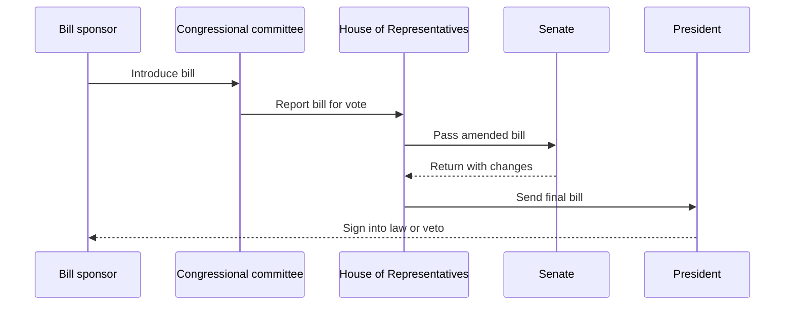
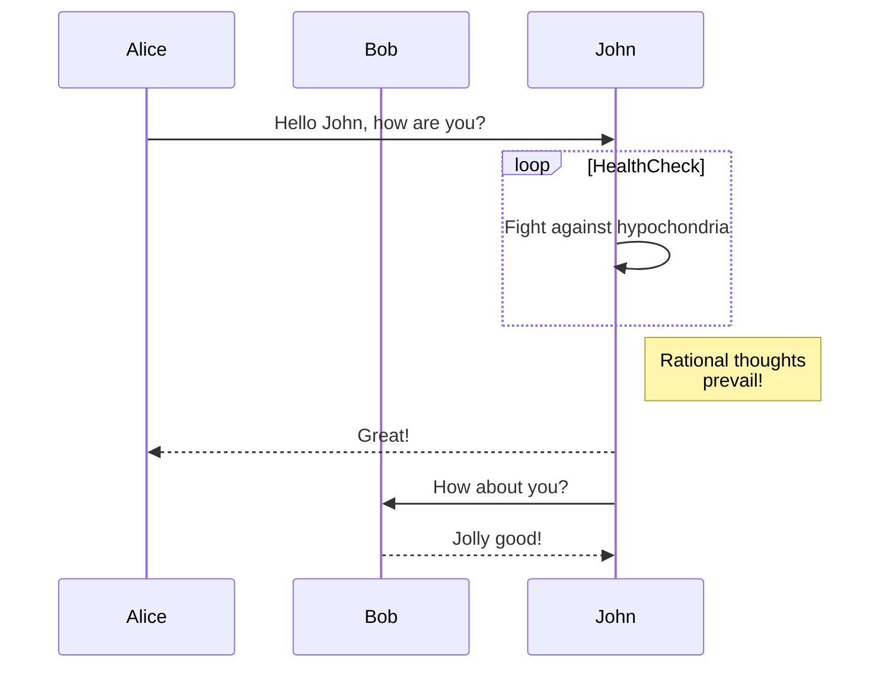

# Mermaid Diagrams

## Overview

 Mermaid is an open source JavaScript-based diagramming syntax that is becoming the standard in the
software documentation industry. Mermaid lets you describe diagrams as simple text and render them into visual flowcharts or sequence diagrams
without image files, right in the browser. Large Language Models (LLMs) can read the plain-text syntax and understand the diagram, even if the LLM doesn't include an image processing component.
So it is very economical for llms to process and learn from Mermaid diagrams.

To learn more about Mermaid diagrams visit [this site](https://mermaid.ai/open-source/intro/index.html).

Mermaid diagrams are useful when you want to explain a process or architecture directly inside your documentation.

### Example 1: Sequence Diagram (How a bill becomes law in the USA) 



If you are curious about the code used to render the previous diagram, it is the following:

```javascript
mermaid
sequenceDiagram
    participant Sponsor as Bill sponsor
    participant Committee as Congressional committee
    participant House as House of Representatives
    participant Senate as Senate
    participant President as President

    Sponsor->>Committee: Introduce bill
    Committee->>House: Report bill for vote
    House->>Senate: Pass amended bill
    Senate-->>House: Return with changes
    House->>President: Send final bill
    President-->>Sponsor: Sign into law or veto
```


### Example 2: Another Sequence Diagram




